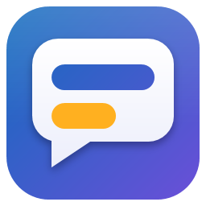

# SLiveTranslator



Live, on-screen translation for games on Windows. It reads the game's text with the OCR engine built into
Windows, translates it, and draws the translation on a transparent, click-through overlay over the game.
Nothing is injected into the game.

* **Subtitles** – pick the strip where the game shows its subtitles once. The app watches it and shows each
  line's translation next to it. The last lines stay on screen a little longer, so fast cutscene dialog can
  still be read, and no line is skipped while another one is translating.
* **Dialog history** – a panel with the recent lines (translation and original) to catch up on what went by.
* **Translate screen** – one hotkey translates every piece of text in the game window (tooltips, item
  names, menus), each label drawn over its original.

It ships with a profile for **The Witcher 3** (English → Vietnamese): names and game terms (Geralt, Ciri,
Roach, witcher, ghoul, Kaer Morhen …) are kept, characters address each other consistently (Vesemir and
Ciri: ta/cháu, Geralt and Yennefer: anh/em), and common machine-translation mistakes are corrected.

## Install

1. Download `SLiveTranslator.exe` (one file, about 190 MB, no .NET install needed) and put it in a folder you can
   write to (Documents, a Games folder; not Program Files), so it can update itself. It uses about 60 MB of memory
   while it waits in the tray.
2. Run it. It lives in the system tray (the blue speech-bubble icon; a green dot means subtitles are on).
3. The first start opens a short setup: language of the app, translation service, subtitle region, and
   a hotkey test. Everything can be changed later in the main window (double-click the tray icon).

Requirements:

* Windows 10 version 2004 or later, or Windows 11.
* A Windows OCR language for the game's language. English is normally installed. To add one:
  **Settings › Time & Language › Language & region › Add a language**, with *Optical character recognition*.
* The game in **borderless or windowed** mode. Exclusive full-screen games cannot be captured.

**Start with Windows** is a switch on the *General & About* page; the app then starts quietly in the tray.

## Using it

| Default hotkey | Action                                                                 |
| -------------- | ---------------------------------------------------------------------- |
| `Ctrl+Shift+S` | Subtitles on/off (asks for the region the first time)                  |
| `Ctrl+Shift+R` | Select the regions: where the subtitles are read, then where the translation goes |
| `Ctrl+Shift+T` | Translate the game window; text under the mouse comes first            |
| `Ctrl+Shift+H` | Dialog history on/off                                                  |
| `Ctrl+Shift+X` | Clear the text; subtitles stay on (the *Timing* page can make it stop them too) |
| `Ctrl+Shift+P` | Private overlay ↔ Shared on screen (see below)                         |

Every hotkey can be recorded anew, switched off or reset on the *Hotkeys* page. A hotkey another program
already uses is shown as *In use* instead of silently not working.

Typical flow:

1. Start the game in borderless mode and start SLiveTranslator.
2. When the first subtitle shows, press `Ctrl+Shift+R` and drag a box around **only the subtitle lines**
   (a wide, low strip). Not the whole screen: that is slow, picks up the HUD and misses lines. The picker
   says right away how many lines it reads there. Enter goes on to the second box: where the translation
   appears (above, below, over the original, or a box you draw) and its background, transparent by default
   with an outlined text. Boxes can be moved, resized by their handles or the arrow keys, and drawn again.
3. Press `Ctrl+Shift+S`. "Subtitles ON" appears and the translation follows the dialog. `Ctrl+Shift+H`
   shows earlier lines.
4. In the inventory, hover an item and press `Ctrl+Shift+T` to translate the tooltip.

Status messages appear at the top of the game screen (Windows hides tray notifications in games). Which
messages show, for how long, where, and with or without a sound is set on the *Notifications* page.

### Subtitles: regions, display and timing

The *Subtitles* group of the main window has four pages:

* **Regions** – both boxes on a picture of the monitor, typed coordinates, a *Test reading* button, where the
  translation goes, its text alignment, and the box behind it (transparent, a colour and its opacity, the
  text outline).
* **Display & sharing** – *Private overlay* (the default) hides the translation from screen sharing,
  recordings and screenshots: only you see it. *Shared on screen* makes it part of the screen, so people in
  Discord, Teams, Meet or OBS see it too; you choose which parts (subtitles, history, translate-screen labels,
  notices). Viewers see it when you share the **whole screen**: a share of only the game window leaves it out.
  In shared mode the translation must keep off the read region (the app's own OCR would read it), so a place
  that covers the region moves above it. The main window stays out of screen sharing unless switched off here.
* **Timing** – how long a line stays after the game hides it (a fixed time, by the line's length at your
  reading speed, or until the next line), the shortest time on screen, fade in and out, a time-left bar,
  whether a new line pushes the older ones up or replaces them, and what Clear does.
* **Reading & OCR** – how often and how the region is read.

### Updates

The app looks for a new version on GitHub when it starts and every 6 hours. A new version must be installed
before the app can be used again: subtitles stop, and the hotkeys, the tray and the main window bring up the
*Update required* window. It shows both versions, the download size and what is new; **Update now** downloads it
with a progress bar (size, percent, speed, time left), puts it in place of the old exe and restarts. Settings, the
translation cache and the history are kept; the old exe and its unpacked files in `%TEMP%\.net` are deleted after
the update. *Quit* (or closing the window) exits.

The download is checked before it is used: its size, its SHA-256 (from the release), and its version. When GitHub
cannot be reached, nothing changes and the app tries again an hour later. *General & About › Updates* shows the
last check and checks now. Only the published exe updates itself, not a build run from the source.

## Translation services

The free services are always the last fallback: when the chosen service has no key, runs out of credit or
does not answer, the free ones translate until it is back, and a notice says so.

| Service | Needs | Notes |
| --- | --- | --- |
| **Free** (default) | nothing | Google Translate, then MyMemory. MyMemory allows 5,000 characters a day, 50,000 with an email (Translation page). |
| **Claude** | Anthropic API key | Best for names, pronouns and idioms: it gets the game profile and the recent dialog with every line. |
| **OpenAI** | OpenAI API key | Responses API with structured output. |
| **Gemini** | Google AI Studio key | Has a free tier (Google may use free-tier data). |
| **OpenAI-compatible** | server address, key if the server needs one | Presets for OpenRouter, DeepSeek, Groq, Mistral, xAI, and local Ollama or LM Studio. |
| **DeepL** | DeepL API key | DeepL API Free gives 500,000 characters a month. |
| **Microsoft Translator** | Azure key and region | |
| **Google Cloud Translation** | API key | |

On the *Translation* page, enter the key and the app checks it right away: the model box stays empty until
the key is valid, then lists the models with ★ Recommended, Balanced and ⚡ Fastest marked. A saved model
is never changed for you. Claude requests use server-side refusal fallbacks on the models that support
them (Fable 5.1, Opus 5.5, Opus 5, Sonnet 5.5), so a line a safety classifier declines is answered by a
fallback model in the same call.

API keys are encrypted with Windows DPAPI for your Windows account. They are never written to logs,
exports or the diagnostics text; a copied data folder on another PC or account asks for them again.
Only the text being translated is sent, and only to the service you chose.

## Game profile and fixing translations

The *Game profile* page edits the profile in use (chosen automatically from the game's process):

* **Keep** – names and terms that stay as they are.
* **Glossary** – fixed translations of game terms.
* **Characters** – who speaks to whom and the forms of address (for AI services).
* **Fix rules** – corrections applied to machine translations, with optional "unless" words.

A line translated wrong can be fixed by hand: in the main window's history, or in the cache manager on
the *Storage & cache* page. A fixed line always wins, for every service.

## Data folder

Settings, the translation cache, game profiles and the log are in `%APPDATA%\SLiveTranslator`. The
*Storage & cache* page shows their sizes, moves the folder elsewhere, clears or exports the cache, and
shows the log. For a **portable** install, put an empty file named `portable.flag` next to the exe: the
data then lives in a `Data` folder beside it.

## Build from source

Needs the .NET 10 SDK.

```bash
dotnet build SLiveTranslator.slnx
dotnet test SLiveTranslator.slnx
dotnet run --project src/SLiveTranslator
```

The tests make no network calls (tests against the real services run only with `SLT_LIVE=1`).

The single-file exe:

```powershell
.\publish.ps1
```

It writes `dist\SLiveTranslator.exe` (self-contained, win-x64, profile
`src/SLiveTranslator/Properties/PublishProfiles/win-x64.pubxml`).

The icon is drawn by a small tool, not part of the solution: `dotnet run --project tools/IconGen` writes
`src/SLiveTranslator/Assets/app.ico` (see `tools/IconGen/README.md`).

### Publishing a release

Every running copy older than the latest release must update to it, so a release has to be right:

1. Raise `<Version>` in `src/SLiveTranslator/SLiveTranslator.csproj` (for example to `2.1.0`) and commit.
2. Run `.\publish.ps1`.
3. Create a GitHub release with the tag `v` + that version (`v2.1.0`), not a draft or pre-release, and attach
   `dist\SLiveTranslator.exe` under exactly that name.

An exe whose version is lower than its tag is refused by the updater (otherwise it would update for ever), so
skipping step 1 leaves every user on the *Update required* window until the release is fixed. Drafts and
pre-releases are never offered. To try an update on this PC without publishing, serve a release JSON and an exe
from `http://127.0.0.1:<port>/` and start the app with `SLT_UPDATE_FEED` set to the JSON's address (only loopback
addresses are taken).

### Diagnostics

```
SLiveTranslator.exe --selftest <folder>          # renders the overlays and the main window; writes PNGs and selftest.txt
SLiveTranslator.exe --bench-subtitles <folder>   # replays painted subtitle scenes through the real OCR; writes timings
SLiveTranslator.exe --translate-screen <folder>  # OCR + translate the primary monitor (real translation requests)
```

## How it works

```
screen region ─► Windows OCR (plain + white-text mask) ─► subtitle tracker ─► profile + context ─► translator chain ─► cache ─► overlay
```

* `Services/SubtitleWatcher.cs` – polls the region and skips frames whose white text did not change. It
  reads the frame and its white-text mask, keeping the cleaner reading.
* `Services/SubtitleTracker.cs` – turns readings into dialog lines: confirmed against recent readings, never
  repeated however differently OCR misreads them, updated when a line grows.
* `Translation/` – the providers (`Providers/`), `ProfileTranslator` (keep names protected, fix rules),
  `FallbackTranslator` (next service on failure), `CachedTranslator` (hand fixes win) and `ProviderRegistry`.
* `UI/` – the click-through overlays (`Overlay/`), the main window and its pages (`Pages/`), the notifier
  surface and the English/Vietnamese strings (`Loc`, `Assets/Strings`).
* `Updates/` – the GitHub release check (`UpdateFeed`), the checked download (`UpdateDownloader`) and the swap of
  the running exe with the cleanup after it (`UpdateInstaller`); `AppUpdates.cs` ties them to the app.

## Known limitations

* Heavily stylised fonts can be misread. White subtitles over snow or bright sky are the hardest case.
* The free Google endpoint is unofficial and blocks some networks; the app then pauses it and uses MyMemory.
* Mixed-DPI multi-monitor setups are supported in principle but were only checked at 100 %.

## Tiếng Việt

SLiveTranslator dịch chữ trong game ngay trên màn hình: phụ đề, chú thích vật phẩm, menu. Ứng dụng đọc chữ
bằng OCR có sẵn của Windows, dịch, rồi hiện bản dịch trên một lớp phủ trong suốt, không can thiệp vào game.

* **Cài đặt:** tải `SLiveTranslator.exe` (một tệp, không cần cài .NET) và chạy. Biểu tượng nằm ở khay hệ thống;
  chấm xanh nghĩa là phụ đề đang bật. Lần đầu chạy sẽ có trình hướng dẫn: ngôn ngữ, dịch vụ dịch, vùng phụ đề,
  thử phím tắt. Muốn mở cùng Windows, bật mục *Khởi động cùng Windows* ở trang *Chung & Giới thiệu*.
* **Dùng:** chơi game ở chế độ cửa sổ hoặc borderless. `Ctrl+Shift+R` chọn vùng đọc phụ đề (chỉ dải phụ đề)
  rồi vùng hiện bản dịch cùng nền của nó (mặc định trong suốt, chữ có viền), `Ctrl+Shift+S` bật/tắt phụ đề,
  `Ctrl+Shift+T` dịch cả màn hình, `Ctrl+Shift+H` xem lịch sử hội thoại, `Ctrl+Shift+X` xóa chữ (phụ đề vẫn
  bật), `Ctrl+Shift+P` đổi giữa *Lớp phủ riêng* (chỉ bạn thấy) và *Hiện trên màn hình chia sẻ* (người xem khi
  bạn chia sẻ cả màn hình cũng thấy). Bản dịch ở lại bao lâu, hiện/mờ dần ra sao: trang *Phụ đề › Thời gian*.
* **Dịch vụ:** mặc định là dịch miễn phí (Google, rồi MyMemory). Có thể dùng Claude, OpenAI, Gemini (có gói miễn
  phí), DeepL, Microsoft hoặc Google Cloud: nhập khóa API, ứng dụng kiểm tra ngay rồi mới hiện danh sách mô hình.
  Khóa được mã hóa cho tài khoản Windows của bạn.
* **The Witcher 3:** có sẵn hồ sơ giữ nguyên tên riêng và thuật ngữ, xưng hô nhất quán. Dòng dịch sai có thể
  sửa tay trong lịch sử hoặc trong trang *Lưu trữ & bộ nhớ đệm*; bản sửa tay luôn được ưu tiên.
* **Dữ liệu:** nằm ở `%APPDATA%\SLiveTranslator`. Đặt tệp `portable.flag` cạnh exe để lưu dữ liệu ngay bên cạnh.
* **Cập nhật:** ứng dụng kiểm tra phiên bản mới trên GitHub khi khởi động và mỗi 6 giờ. Khi có bản mới, phải cập nhật
  mới dùng tiếp được: cửa sổ *Cần cập nhật* cho biết dung lượng tải, thanh tiến trình, rồi ứng dụng tự khởi động lại
  và xóa phiên bản cũ. Cài đặt, bộ nhớ đệm và lịch sử được giữ nguyên. Hãy để exe ở thư mục có quyền ghi (không phải
  Program Files).
